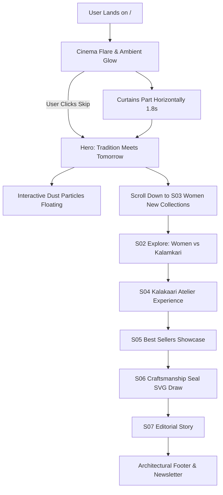
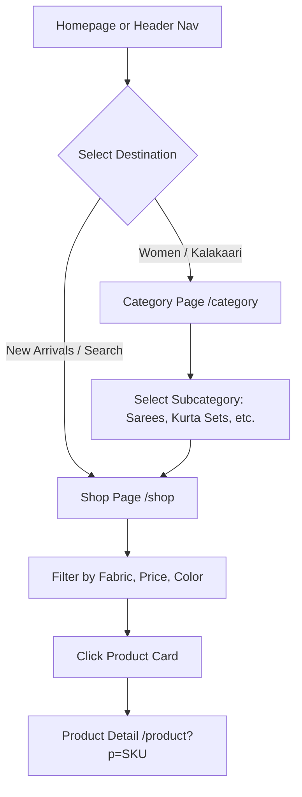
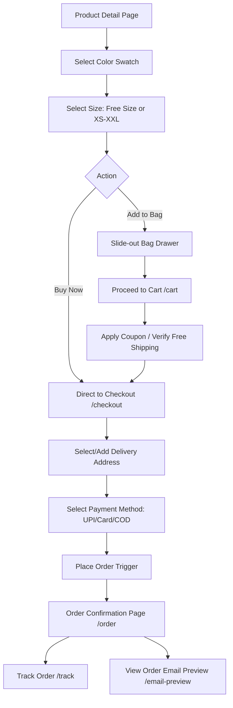

# UX Flows & User Journeys
## Project: Mahira Select — High-Fidelity Website Reconstruction

### 1. Customer Acquisition & First Impression Flow

---

### 2. Browsing & Product Discovery Flow

---

### 3. Purchasing & Fulfillment Flow

